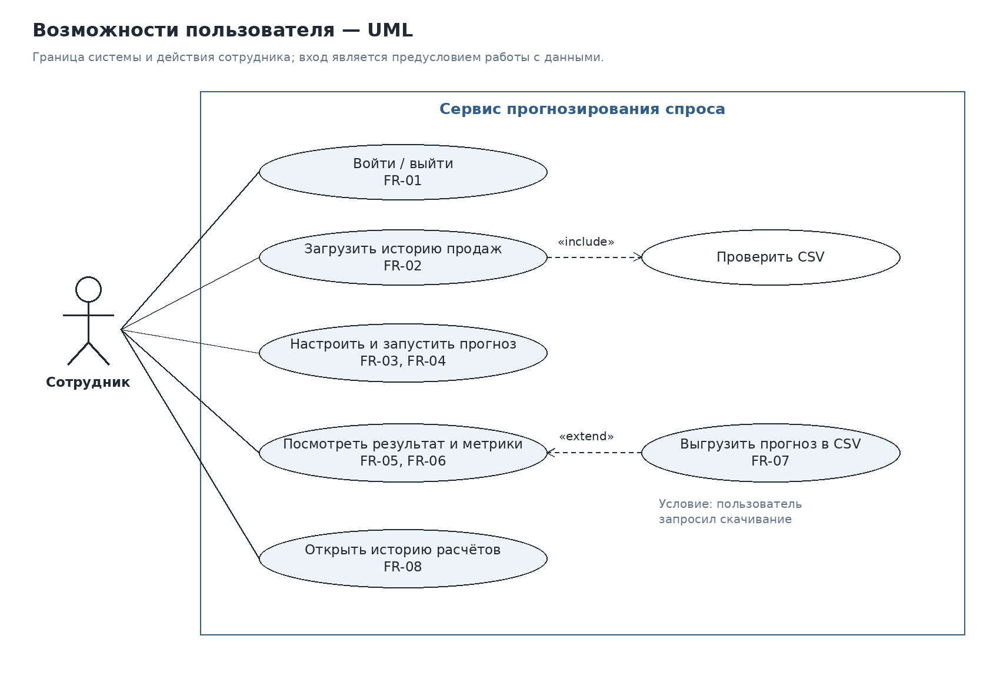
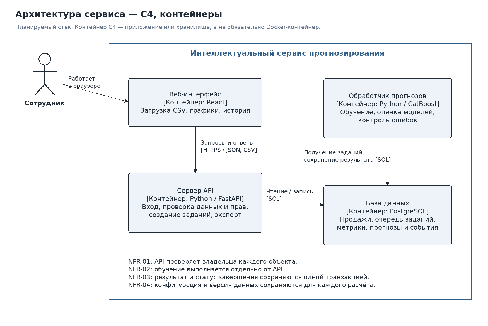
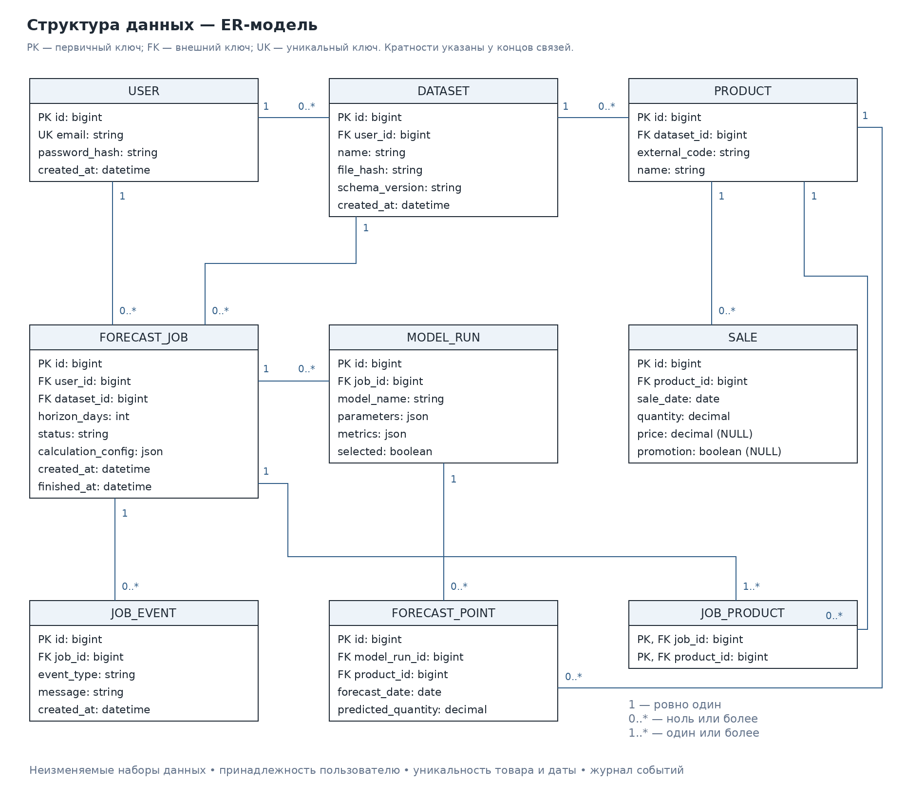
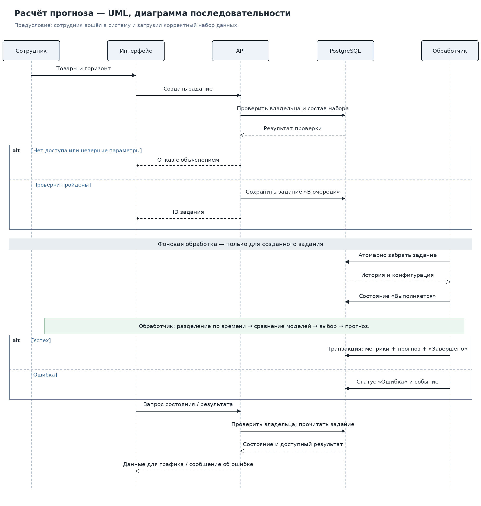
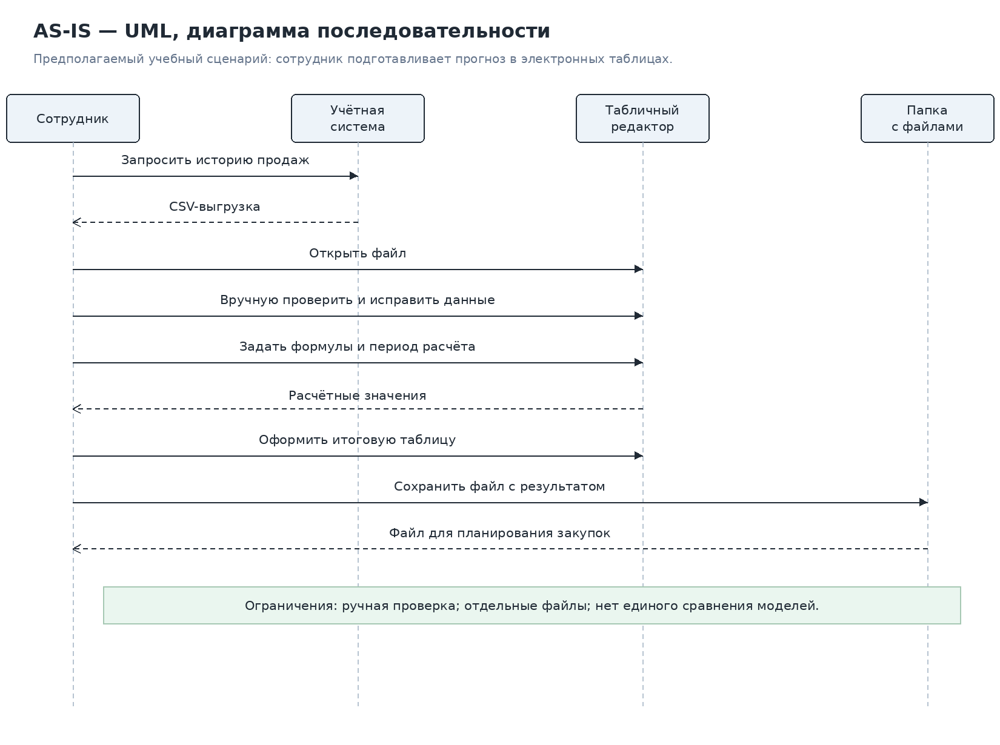
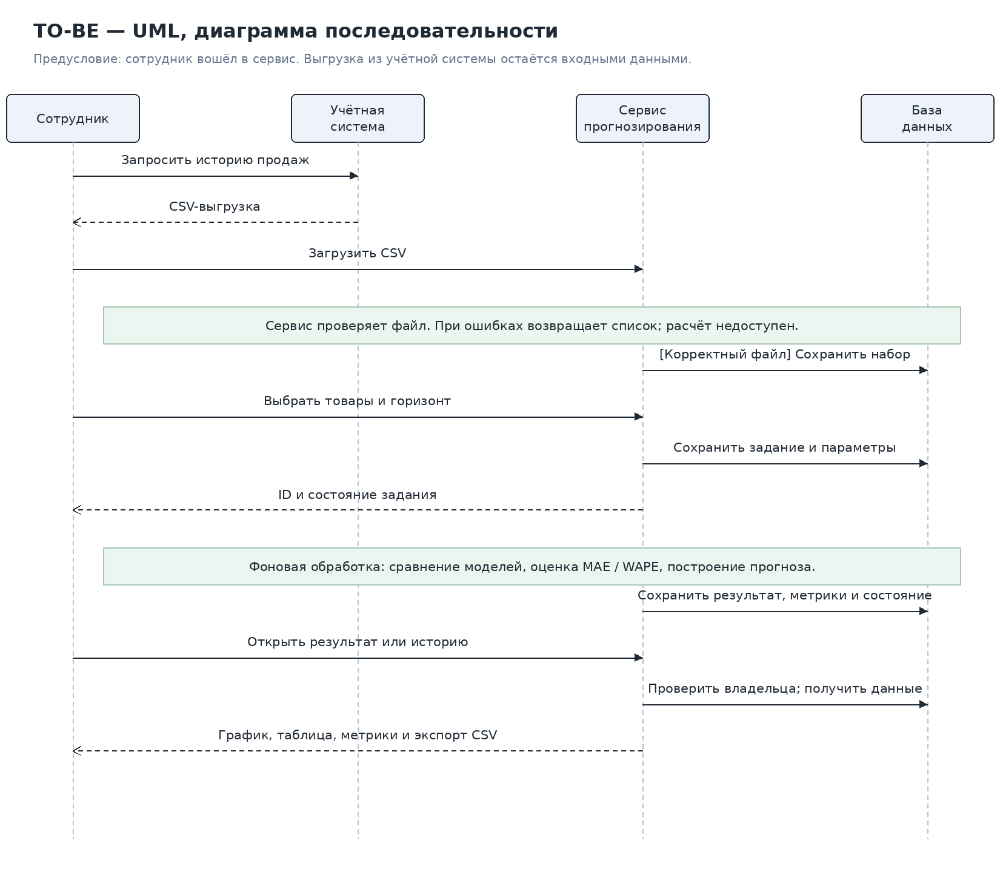

# ЛР 3 — проектирование

**Тема ВКР:** Разработка интеллектуального сервиса для прогнозирования спроса на товары повседневного спроса

**Автор или участники команды:** Игнатенкова Милана Сергеевна, К3421. 

**Вклад каждого участника при командной работе:** Работа выполняется индивидуально. 

## 1. Предметная область и требования

### Описание предметной области

В розничной торговле прогноз продаж помогает планировать закупки. Если товаров недостаточно, магазин может потерять продажи. Избыточный запас увеличивает расходы на хранение и риск списания продукции.

Разрабатываемый сервис предназначен для сотрудника, который анализирует продажи и планирует закупки. Пользователь загружает историю продаж, выбирает товары и период прогнозирования, получает график и таблицу с прогнозом, оценивает качество моделей и выгружает результат.

Основной результат ВКР — веб-сервис, объединяющий подготовку данных, запуск расчётов и представление результатов. Для прогнозирования предполагается сравнить сезонный наивный метод и CatBoost. В сезонном наивном методе повторяются продажи последней доступной недели. Машинное обучение является частью сервиса, разработка новой архитектуры модели не предполагается.

Обязательные поля входного CSV: дата, код товара и количество проданных единиц. Цена и сведения о промоакциях используются при наличии. Календарные признаки формируются по дате. Для будущего периода допускаются только факторы, известные на момент составления прогноза.

В прототипе один набор данных описывает одну торговую точку или заранее агрегированные продажи. Если исходные данные включают несколько магазинов, перед загрузкой выбирается один магазин либо выполняется согласованная агрегация.

Без сведений об остатках сервис прогнозирует фактические продажи. Продажи при отсутствии товара не отражают весь потенциальный спрос. Автоматическое формирование заказов поставщикам в границы прототипа не входит: решение о закупке принимает сотрудник.

### Функциональные требования

| ID | Требование | Как проверить выполнение |
|---|---|---|
| FR-01 | Сервис должен позволять пользователю с созданной учётной записью входить в систему и завершать сеанс. | Проверить вход с корректным и неверным паролем, затем выход и невозможность продолжить работу с завершённым сеансом. |
| FR-02 | Сервис должен загружать CSV и проверять обязательные поля, формат дат, числовые значения, неотрицательное количество продаж и уникальность пары «товар — дата». Некорректный файл должен отклоняться со списком ошибок. | Загрузить корректный файл и файлы с каждой из перечисленных ошибок. Проверить, что ошибочные данные не сохранены как доступный для расчёта набор. |
| FR-03 | Пользователь должен иметь возможность выбрать собственный набор данных, один или несколько товаров и горизонт от 1 до 28 дней. | Проверить допустимые параметры, пустой список товаров, чужой набор и горизонт вне диапазона. |
| FR-04 | Прогноз должен рассчитываться в фоне. Пользователь должен видеть состояние задания: «В очереди», «Выполняется», «Завершено» или «Ошибка». | Запустить расчёт и проверить изменение состояния. Искусственно вызвать ошибку и проверить её отображение. |
| FR-05 | Сервис должен сравнивать сезонный наивный метод и CatBoost на одном отложенном временном интервале по MAE и WAPE. При нулевой сумме фактических продаж WAPE должна отображаться как неопределённая. | Проверить хронологическое разделение данных и сопоставить метрики с ручным расчётом на небольшом примере. |
| FR-06 | Сервис должен показывать историю продаж и прогноз на графике и в таблице, а также выбранную модель и метрики сравнения. | Сопоставить значения интерфейса с сохранёнными результатами завершённого задания. |
| FR-07 | Пользователь должен иметь возможность скачать CSV с кодом товара, датой, прогнозным количеством и названием модели. | Скачать файл и проверить столбцы, количество строк и соответствие показанному прогнозу. |
| FR-08 | Сервис должен хранить историю заданий пользователя, их параметры, время запуска, состояния и результаты, позволяя повторно открывать расчёты. | Выполнить несколько расчётов, повторно войти в систему и открыть историю и результаты. |

Учётные записи для испытания прототипа создаются заранее. Самостоятельная регистрация пользователей не является обязательной функцией этой версии.

### Нефункциональные требования

| ID | Требование | Как проверить выполнение |
|---|---|---|
| NFR-01 | Пользователь должен иметь доступ только к своим данным, заданиям и результатам. Пароли хранятся в виде стойких хешей; опубликованный сервис использует HTTPS. | Создать два аккаунта, проверить обращения к чужим объектам через интерфейс и API. Проверить хеширование паролей и HTTPS. |
| NFR-02 | При пяти одновременно работающих пользователях 95% запросов списка заданий и состояния расчёта должны выполняться не более чем за 2 секунды на стенде с 4 CPU и 8 ГБ RAM. Список должен выдаваться страницами не более 50 заданий. | Провести нагрузочную проверку этих запросов во время одного фонового расчёта; измерить 95-й процентиль времени ответа. |
| NFR-03 | Частичный результат не должен отображаться как завершённый прогноз. Результаты и статус «Завершено» сохраняются одной транзакцией. При сбое фиксируются состояние «Ошибка» и событие с ID задания. | Искусственно прервать расчёт и сохранение. Проверить отсутствие завершённого частичного результата и наличие записи об ошибке. |
| NFR-04 | Для каждого расчёта должны сохраняться идентификатор неизменяемого набора, хеш файла, правила подготовки признаков, границы временных выборок, параметры моделей, версии библиотек и случайное зерно. | Проверить наличие параметров; повторить расчёт в том же программном окружении и сопоставить прогнозы с абсолютной погрешностью не более 0,000001. |

## 2. Обзор нотаций и видов диаграмм

| Нотация или вид диаграммы | Что описывает | Сильные стороны |
|---|---|---|
| BPMN | Бизнес-процессы, участников, события и условия выполнения действий. | Позволяет распределить ответственность и показать основной процесс и исключения. |
| DFD | Потоки данных между участниками, процессами и хранилищами. | Помогает проследить происхождение, обработку и сохранение данных. |
| ER-модель | Сущности, атрибуты и связи между ними. | Подходит для проектирования базы данных, ключей и ограничений целостности. |
| UML — диаграмма вариантов использования | Возможности системы с точки зрения её пользователей. | Показывает границы системы и связывает функции с ролями. |
| UML — диаграмма последовательности | Обмен сообщениями между участниками во времени. | Позволяет разобрать сценарий, порядок проверок и обработку альтернативных исходов. |
| UML — диаграмма состояний | Состояния объекта и переходы между ними. | Подходит для жизненного цикла задания и описания ошибок. |
| UML — диаграмма развёртывания | Размещение программных элементов на вычислительных узлах. | Помогает описать инфраструктуру и соединения между узлами. |
| C4 — диаграмма контейнеров | Приложения и хранилища, их обязанности, технологии и взаимодействия. | Даёт общее представление об архитектуре без детализации до отдельных классов. |

## 3. Выбор нотаций для проекта

Выбраны четыре вида диаграмм. Они показывают возможности пользователя, архитектуру, данные и выполнение сценариев.

| Нотация или вид диаграммы | Что моделируем | Связанные требования | Почему подходит |
|---|---|---|---|
| UML — варианты использования | Вход, загрузку данных, запуск прогноза, просмотр, историю и экспорт. | FR-01–FR-08 | Позволяет проверить, что все основные пользовательские действия предусмотрены. |
| C4 — контейнеры | Веб-интерфейс, API, фоновый обработчик и PostgreSQL. | FR-02, FR-04, FR-06–FR-08; NFR-01–NFR-04 | Показывает распределение функций, отдельное выполнение обучения и места проверки доступа и хранения данных. |
| ER-модель | Владельцев данных, продажи, задания, запуски моделей, прогнозы и события. | FR-01–FR-08; NFR-01, NFR-03, NFR-04 | Определяет структуру хранения и связи, необходимые для истории и повторения расчётов. |
| UML — последовательность | Запуск расчёта и получение результата; сценарии AS-IS и TO-BE. | FR-02–FR-08; NFR-01–NFR-04 | Показывает порядок взаимодействий, проверки, фоновую обработку и различия между ручным и автоматизированным процессами. |

## 4. Модели системы

### 4.1. Возможности пользователя — UML, диаграмма вариантов использования

**Диаграмма:**

**Пояснение модели:**

Основной участник — сотрудник, который анализирует продажи. Внутри границы сервиса показаны доступные ему функции. Загрузка файла включает обязательную проверку CSV: это связь `include`. Выгрузка CSV является дополнительным действием при просмотре результата и выполняется по запросу пользователя: это связь `extend`.

Для работы с наборами данных и прогнозами требуется действующий сеанс. Вход показан отдельным вариантом использования; он не повторяется при каждом действии.

**Отражённые функциональные требования и элементы модели:**

Вход и выход соответствуют FR-01, загрузка с проверкой — FR-02, настройка и запуск — FR-03 и FR-04. Просмотр результата и метрик отражает FR-05 и FR-06, выгрузка — FR-07, история расчётов — FR-08. Детали сравнения моделей раскрываются в сценарии расчёта.

**Нефункциональные требования и проектные решения:**

Для NFR-01 все действия с данными доступны только вошедшему пользователю. Фактическая проверка принадлежности объекта выполняется сервером и показана в следующих моделях. Диаграмма вариантов использования сама по себе не доказывает безопасность или производительность.

### 4.2. Архитектура — C4, диаграмма контейнеров

**Диаграмма:**

**Пояснение модели:**

Веб-интерфейс на React предоставляет формы загрузки и настройки расчёта, графики и историю. API на Python с FastAPI выполняет вход, проверку прав, валидацию файлов, создание заданий и экспорт. Фоновый обработчик на Python подготавливает признаки, сравнивает модели и формирует прогноз. PostgreSQL хранит данные и очередь заданий.

Контейнер C4 обозначает приложение или хранилище. Он не обязательно совпадает с контейнером Docker. На данном этапе перечисленные технологии являются выбранным вариантом реализации.

API сохраняет задание в базе и возвращает его ID. Обработчик самостоятельно получает задания из PostgreSQL. Отдельный брокер сообщений в прототипе не требуется. Один обработчик выполняет одно задание за раз, чтобы обучение не занимало все ресурсы сервера.

**Отражённые функциональные требования и элементы модели:**

API обеспечивает загрузку и проверку данных — FR-02, создание заданий — FR-03 и FR-04, экспорт и историю — FR-07 и FR-08. Обработчик выполняет прогнозирование и сравнение моделей — FR-04 и FR-05. Интерфейс представляет результаты — FR-06.

**Нефункциональные требования и проектные решения:**

NFR-01 учитывается проверкой сеанса и владельца на стороне API, хешированием паролей и HTTPS. База данных не предоставляется браузеру напрямую.

Для NFR-02 обучение вынесено из обработки HTTP-запросов. Список заданий выдаётся страницами. В базе предусматриваются индексы по владельцу и времени создания, а также по состоянию задания.

Для NFR-03 обработчик сохраняет прогноз и статус завершения одной транзакцией. В журнал записываются ошибки и ID задания. Контроль активности позволяет обнаружить аварийно прерванный расчёт и перевести задание в состояние «Ошибка».

Для NFR-04 сохраняются версия данных и полная конфигурация расчёта. Численные ограничения подтверждаются тестированием реализации, а не самим наличием схемы.

### 4.3. Структура данных — ER-модель

**Диаграмма:**

**Пояснение модели:**

Пользователь USER владеет наборами DATASET и заданиями FORECAST_JOB. Набор содержит товары PRODUCT и наблюдения продаж SALE. Выбранные для задания товары связываются с ним через JOB_PRODUCT.

MODEL_RUN хранит сведения о проверенных моделях, их параметры, метрики и признак выбора. FORECAST_POINT содержит прогнозные значения для выбранной модели по товарам и датам. JOB_EVENT хранит события выполнения и ошибки.

На связях явно указаны кратности: `1` — ровно один объект, `0..*` — ноль или более, `1..*` — один или более. Например, одно задание включает один или несколько выбранных товаров, но до начала обработки может не иметь ни одного запуска модели.

После загрузки набор данных не изменяется. Исправленная история загружается как новый набор. В конфигурации задания сохраняются правила подготовки признаков, временные границы, версии библиотек и случайное зерно.

Предусмотрены ограничения:

- email пользователя уникален;
- код товара уникален внутри набора;
- пара «товар — дата продажи» уникальна;
- количество продаж и прогнозное количество неотрицательны;
- горизонт находится в диапазоне от 1 до 28 дней;
- пара «задание — выбранный товар» уникальна;
- сочетание запуска модели, товара и даты прогноза уникально;
- выбранные товары относятся к набору задания, а набор принадлежит пользователю задания.

Последние межтабличные проверки выполняет API внутри транзакции создания задания. Цена и сведения о промоакции могут отсутствовать: отсутствие значения не приравнивается к нулевой цене или подтверждённому отсутствию акции.

**Отражённые функциональные требования и элементы модели:**

USER поддерживает FR-01. DATASET, PRODUCT и SALE обеспечивают хранение загруженной истории — FR-02. FORECAST_JOB и JOB_PRODUCT фиксируют выбор и состояния — FR-03 и FR-04. MODEL_RUN хранит сравнение моделей — FR-05. FORECAST_POINT используется для графика, таблицы и CSV — FR-06 и FR-07. Все сохранённые задания и результаты образуют историю — FR-08.

**Нефункциональные требования и проектные решения:**

Ссылки на владельца используются при проверке прав — NFR-01. Связи и ограничения, транзакционное сохранение и журнал событий поддерживают NFR-03. Неизменяемый набор, хеш файла и конфигурация позволяют повторить расчёт — NFR-04.

### 4.4. Расчёт прогноза — UML, диаграмма последовательности

**Диаграмма:**

**Пояснение модели:**

Предусловия сценария: сотрудник вошёл в систему и загрузил корректный набор. Пользователь выбирает товары и горизонт. API проверяет права и параметры. При ошибке возвращается отказ; при успехе создаётся задание.

Обработчик атомарно получает задание из очереди и переводит его в состояние «Выполняется». Это предотвращает одновременное получение одного задания несколькими обработчиками.

Последний исторический интервал длиной, равной горизонту, используется для проверки. Предшествующие данные используются для обучения. Признаки вычисляются без доступа к будущим продажам; при многошаговом прогнозе используются только сведения, доступные на момент соответствующего расчёта. Для обоих методов применяется одинаковый проверочный интервал.

Выбирается модель с меньшей MAE по всем выбранным товарам на проверочном интервале. При равной MAE выбирается сезонный наивный метод. WAPE показывается как дополнительная метрика. После выбора модель обучается на всей доступной истории и строит будущий прогноз. Отрицательные значения приводятся к нулю; это правило одинаково применяется при оценке и прогнозировании и сохраняется в конфигурации.

Если данных недостаточно для признаков и проверки, задание получает состояние «Ошибка» с объяснением. Пропущенные даты не считаются нулевыми продажами автоматически: правило обработки пропусков должно быть явно определено в конфигурации подготовки данных.

При успешном выполнении результаты, метрики и статус сохраняются одной транзакцией. При сбое сохраняются ошибка и событие. Интерфейс запрашивает состояние и показывает доступный результат. Старое задание открывается тем же способом, без повторного обучения.

**Отражённые функциональные требования и элементы модели:**

Создание задания отражает FR-03, очередь и состояния — FR-04, обработка моделей — FR-05. Получение результата соответствует FR-06 и повторному просмотру из FR-08. Загрузка файла и экспорт показаны отдельно в пользовательской модели и сценарии TO-BE.

**Нефункциональные требования и проектные решения:**

Проверка владельца учитывает NFR-01. Возврат ID до окончания расчёта и отдельный обработчик учитывают NFR-02. Альтернативы успеха и сбоя, транзакция и журнал учитывают NFR-03. Получение сохранённой конфигурации и неизменяемой истории учитывает NFR-04.

## 5. AS-IS и TO-BE

**Выбранная нотация:** UML — диаграмма последовательности.

Обе схемы показывают одну задачу: подготовку прогноза для планирования закупок. AS-IS — предполагаемый учебный сценарий, а не результат обследования конкретного магазина.

### AS-IS — текущее состояние

**Диаграмма:**

**Описание и ограничения:**

Сотрудник получает CSV из учётной системы и открывает его в табличном редакторе. Он самостоятельно проверяет данные, исправляет ошибки, задаёт формулы и период расчёта. Итоговая таблица сохраняется в папке с файлами.

В выбранном сценарии нет общей истории заданий, единых автоматических проверок и встроенного сравнения моделей на отложенных данных. Повторение расчёта требует найти файл и восстановить настройки. Ручное редактирование создаёт риск ошибок. Эти ограничения относятся к рассматриваемому процессу, а не ко всем возможностям табличных редакторов.

### TO-BE — предлагаемое состояние

**Диаграмма:**

**Описание изменений:**

Получение выгрузки из учётной системы сохраняется. Сотрудник загружает файл в сервис, который проверяет его и сообщает об ошибках. После успешной загрузки пользователь выбирает товары и горизонт, а сервис создаёт задание.

Расчёт выполняется в фоне. Система сравнивает модели, сохраняет параметры, метрики и прогноз. Сотрудник получает график, таблицу и возможность выгрузки CSV. История доступна для повторного просмотра.

На этой схеме сервис представлен одним участником. Его внутреннее разделение на интерфейс, API и обработчик раскрыто в разделах 4.2 и 4.4. TO-BE показывает успешный расчёт; альтернативы сбоя рассмотрены на подробной диаграмме последовательности.

### Обоснование перехода

| Ограничение AS-IS | Решение TO-BE | Где видно изменение | Требования |
|---|---|---|---|
| Сотрудник проверяет файл вручную. | Сервис автоматически проверяет структуру и значения. | После загрузки CSV добавлена автоматическая проверка. | FR-02 |
| Настройки задаются формулами в таблице. | Товары и горизонт выбираются через интерфейс и сохраняются в задании. | Сообщения «Выбрать товары и горизонт» и «Сохранить задание и параметры». | FR-03, FR-08 |
| Нет единого сравнения методов. | Обработчик сравнивает модели на одном временном интервале. | Блок фоновой обработки с оценкой MAE и WAPE. | FR-05 |
| Результаты находятся в отдельных файлах. | Задания и результаты сохраняются в базе с привязкой к пользователю. | Сохранение результата и запрос истории. | FR-08, NFR-01, NFR-04 |
| Представление результата оформляется вручную. | Сервис формирует график, таблицу и CSV. | Ответ сервиса пользователю в конце TO-BE. | FR-06, FR-07 |
| Нет единого учёта хода расчёта. | Сохраняются состояния и события задания. | Возврат ID и состояния; сохранение результата и состояния. | FR-04, NFR-03 |

Переход обеспечивают серверная проверка данных, отдельный обработчик, единое хранилище и пользовательский интерфейс. Ожидается сокращение ручных действий и упрощение повторного просмотра расчётов. Улучшение точности нельзя считать заранее доказанным: оно проверяется экспериментально.

## 6. Выводы

Выбранные диаграммы показывают сервис с четырёх сторон. Варианты использования описывают действия сотрудника. C4 показывает приложения и хранилище. ER-модель определяет данные и связи. Диаграммы последовательности раскрывают порядок работы и обработку результатов.

Модели согласованы: пользователь загружает набор, создаёт задание, обработчик получает его из базы и сохраняет прогноз. Результат связан с владельцем, исходными данными и параметрами модели. Это позволяет проверять права и возвращаться к ранее выполненным расчётам.

В TO-BE проверка файлов, сравнение моделей и подготовка результатов выполняются сервисом. Сотрудник выбирает параметры и использует прогноз при планировании закупок. Производительность, устойчивость к сбоям и качество прогнозирования необходимо подтвердить после реализации.
